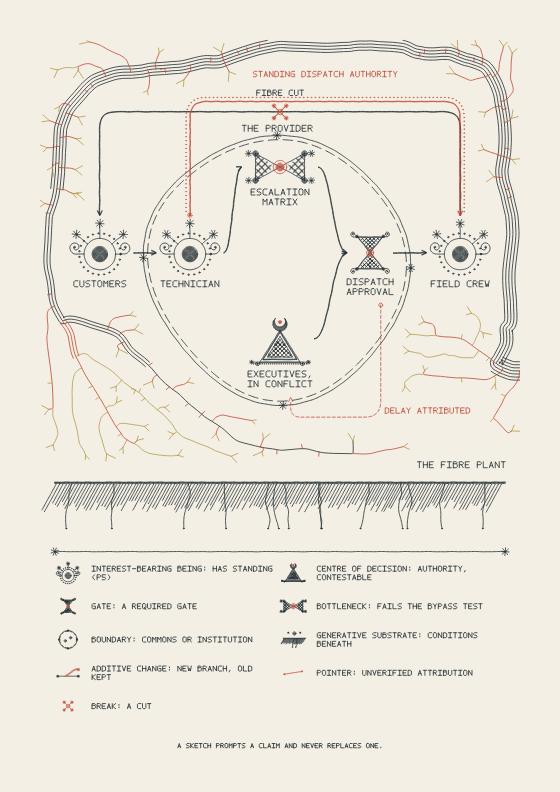

# Linework — Pen Plot Studio

Generates reproducible, layered SVG line drawings for pen plotters. It has four motifs: flow ribbons, signal bands, wire structures and branching growth. They can be blended through soft regions and overlays. Diagrams in the sketching marks of the Clavicula Matricis can be laid over them, each with a key stating what its marks mean.



## Run it

You need [Node.js](https://nodejs.org) 18 or newer. Nothing else needs installing.

```sh
npm start
```

Then open <http://localhost:8080/>. Use `PORT=9000 npm start` for a different port.

Opening `dist/index.html` directly from the file system will not work. Browsers block JavaScript modules and workers on `file://` pages, so the page has to be served over HTTP. Any static server pointed at `dist/` works, for example `python3 -m http.server -d dist 8080`.

## Test

```sh
npm test
```

Technical notes, the output contract and engine usage are in [dist/README.md](dist/README.md).
